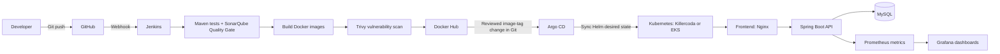

# Three-Tier Todo — DevOps Engineering Lab

A React/Vite frontend, Spring Boot REST API, and MySQL database used to practise a realistic DevOps delivery workflow. This is a **three-tier application, not a microservices application**: the backend is one Spring Boot service. This repository is based on the application from [17J/Three-Tier-Todo-Application](https://github.com/17J/Three-Tier-Todo-Application), with a separate DevOps engineering upgrade branch.

> **Status:** the `upgrade/production-ready-devops` branch contains a proposed upgrade that still needs runtime validation. Do not describe it as production-ready until the build, security gates, deployment, monitoring, rollback, and recovery exercises have actually passed.

## Architecture



## What the upgrade adds

- Jenkins CI pipeline that runs Maven verification, SonarQube analysis and Quality Gate enforcement, frontend lint/build, immutable image builds, Trivy scanning, and optional credential-backed Docker Hub publishing. Jenkins does not deploy Kubernetes resources.
- Multi-stage container builds, a non-root backend runtime, unprivileged Nginx frontend, and same-origin `/api` routing.
- Docker Compose health checks, service networking, and startup ordering.
- Helm chart for frontend, backend, and MySQL with probes, resource requests/limits, externalized database credentials, optional HPA, ALB Ingress, and Prometheus ServiceMonitor.
- Argo CD Application manifest and dedicated GitOps values file. Kubernetes delivery is controlled by reviewed image-tag changes in Git; Argo CD owns reconciliation.
- Terraform scaffold for AWS VPC/EKS, with endpoint CIDR restriction and cost-aware cleanup instructions.
- Runbooks for Kubernetes troubleshooting, rollback/recovery, and monitoring.

## Repository layout

```text
backend/                       Spring Boot API and Dockerfile
frontend/                      React/Vite UI, Nginx config and Dockerfile
docker-compose.yml             Local three-tier stack
Jenkinsfile                    Jenkins CI pipeline
argocd/                        Argo CD Application and GitOps guide
sonar-project.properties       SonarQube source configuration
.github/workflows/             Pull request validation checks
helm/taskmanager/              Helm chart and Killercoda/EKS values
terraform/eks/                 Terraform VPC/EKS lab scaffold
monitoring/                    Prometheus/Grafana practice guide
docs/                          Setup guides, roadmap and runbooks
K8s/                           Legacy Kubernetes examples; not canonical
azure-pipelines.yml             Legacy pipeline example
```

## 1. Local validation with Docker Compose

Requirements: Git and Docker. Docker Compose v2 is preferred; on Killercoda, use `docker-compose` if the `docker compose` plugin is unavailable.

```bash
git clone --branch upgrade/production-ready-devops --single-branch https://github.com/An619/three-tier-todo-devops.git
cd three-tier-todo-devops

docker-compose config
docker-compose up -d --build
docker-compose ps
curl -fsS http://localhost:8085/actuator/health
curl -I http://localhost:3000
```

Open `http://localhost:3000` for the UI. API calls go through Nginx to the backend service. Compose has local-only fallback passwords for disposable practice; set strong local values before using it outside a lab.

Useful commands:

```bash
docker-compose logs -f
docker-compose logs -f backend
docker-compose logs -f mysql
docker-compose down
```

Only use `docker-compose down -v` when you intentionally want to delete the local MySQL volume and all data stored in it.

## 2. Practise on Killercoda first

Follow [docs/deploy-killercoda.md](docs/deploy-killercoda.md) for the step-by-step sequence:

1. Build and verify the application locally.
2. Build and push uniquely tagged images to your Docker Hub account.
3. Create the `taskmanager-db` Secret outside Git.
4. Run `helm lint` and install the chart with `values-killercoda.yaml`.
5. Verify Pods, Services, logs, events, and the UI using port-forward/web preview.
6. Clean up the Helm release and namespace.

The Killercoda values use ephemeral database storage, so data can be lost if the MySQL Pod is recreated.

## 3. Jenkins pipeline

See [docs/jenkins-setup.md](docs/jenkins-setup.md) and [SonarQube setup](docs/sonarqube-setup.md) before running Jenkins. The CI agent needs Git, JDK 17, Maven, Node.js/npm, Docker daemon access, Trivy, and the SonarQube Scanner. Helm/kubectl are needed for separate manual lab exercises, not the Jenkins CI pipeline.

Create the documented Jenkins credentials before enabling image publishing:

- `dockerhub-creds` — Docker Hub username and access token.
- Argo CD is configured separately in the target cluster. Jenkins CI does not need cluster credentials.
- Do not create Kubernetes credentials in Jenkins for the standard CI pipeline; Argo CD owns delivery.

Configure the Jenkins job to use this repository and branch, then set up a secure GitHub webhook if Jenkins is reachable from GitHub. Start with `PUBLISH_IMAGES=false`; only publish after the test, Quality Gate, and scan stages pass. The frontend lint stage may expose existing application issues that must be fixed rather than bypassed. See [argocd/README.md](argocd/README.md) for the GitOps release workflow.

## 4. Helm chart

Chart path: `helm/taskmanager`.

- `values-killercoda.yaml` — low-footprint, disposable lab configuration.
- `values-eks.yaml` — ALB Ingress, autoscaling, and persistent database storage; requires AWS Load Balancer Controller, metrics-server, and EBS CSI support.

The chart expects a Secret named `taskmanager-db` with keys `mysql-root-password`, `db-username`, and `db-password`. Do not commit these values. See the deployment guide for safe setup.

## 5. Terraform and AWS EKS

Start with [terraform/eks/README.md](terraform/eks/README.md). The Terraform files are a learning scaffold and have not been applied or validated against your AWS account.

**AWS costs are possible** for EKS, EC2 nodes, NAT Gateway, EBS volumes, ALB, public IPv4 addresses, and data transfer. Set a budget alert, inspect `terraform plan`, and destroy the lab after practice. Replace the example EKS API CIDR with your own public IP in `/32` form before applying.

## 6. Monitoring

Follow [monitoring/README.md](monitoring/README.md) to install kube-prometheus-stack, enable the backend ServiceMonitor, and practise Prometheus/Grafana. The application exposes `/actuator/prometheus` for scraping; do not expose Actuator endpoints publicly.

## Troubleshooting and recovery

- [Kubernetes troubleshooting runbook](docs/runbooks/kubernetes-troubleshooting.md)
- [Rollback and recovery runbook](docs/runbooks/rollback-and-recovery.md)
- [Production engineering roadmap](docs/production-engineering-roadmap.md)

For each failure exercise, record the symptoms, evidence, impact, root cause, mitigation, and a test that prevents recurrence. Redact credentials from screenshots and logs.

## Known application limitations

- The current frontend authentication flow is a demo that stores user records and passwords in browser `localStorage`; it is **not secure for real users**. Do not use real passwords or present this authentication as production-ready. Replace it with server-side authentication, password hashing, session/token lifecycle controls, and authorization before any real deployment.
- The app is one Spring Boot backend plus a MySQL database. Docker/Kubernetes do not make it microservices; a genuine microservices conversion would require separate business services and ownership boundaries.
- The Compose fallback credentials are for disposable local labs only. Use managed secrets and unique credentials outside the lab.

## Scope and honesty

This project can help demonstrate advanced DevOps engineering skills when its workflows are run successfully and you can explain the trade-offs. It does not itself establish five years of professional work experience. Keep screenshots and logs of real test runs; do not claim stages have passed until they have.

The original application and its upstream project structure are credited to [17J](https://github.com/17J/Three-Tier-Todo-Application).
