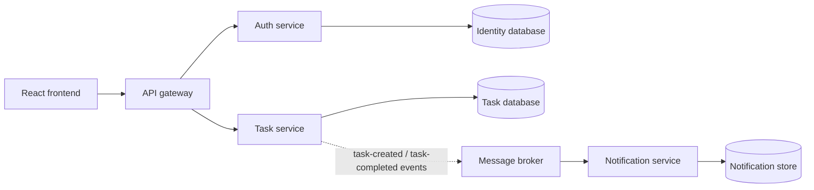

# Target architecture and migration sequence

## Service contracts

- `auth-service`: `POST /api/auth/register`, `POST /api/auth/login`, `GET /api/auth/me`; store password hashes only and issue short-lived signed tokens.
- `task-service`: task CRUD; require a valid token and scope every read/write/delete to the authenticated subject.
- `notification-service`: consume versioned task events idempotently; do not synchronously block task CRUD on email or notification delivery.
- `api-gateway`: route `/api/auth/**` and `/api/tasks/**`; apply request limits and forward trace/correlation IDs.

## Delivery model

Build and scan an immutable image per service. Jenkins runs unit/integration tests, SonarQube quality gates, Trivy and SBOM generation, then publishes images. Jenkins updates a reviewed GitOps values file; Argo CD reconciles Helm releases. Kubernetes readiness/liveness probes and service-specific resource limits are required.

This is the target design. Only the task-service extraction is included in this phase; do not treat the target diagram as implemented functionality.
